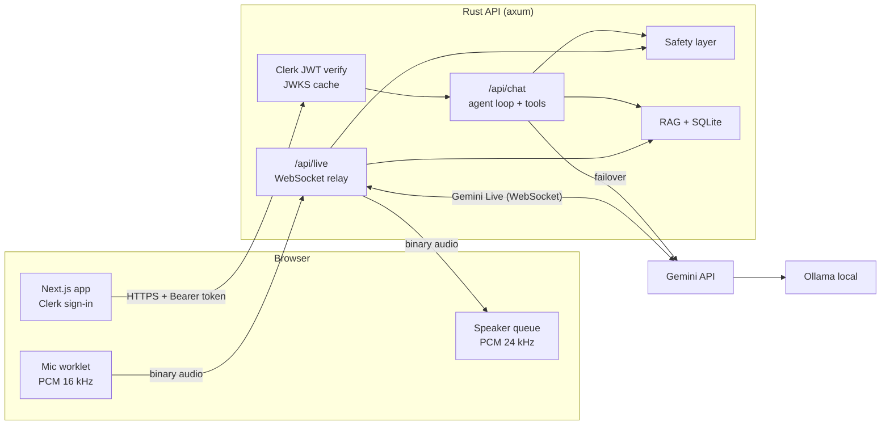

<div align="center">

# 🩺 Sehat Saathi

**A bilingual (English + Hindi) AI health assistant you can type to, or just talk to, like a phone call.**

[](../../actions/workflows/ci.yml)
[](../../watchers)


</div>

> **Not a medical device.** Sehat Saathi shares general health information and triage guidance. It does not diagnose, prescribe or replace a doctor. See [Safety](#safety-by-design) and [Before real patients use it](#before-real-patients-use-it).

## Highlights

- 🎙️ **Real speech-to-speech conversation.** Press the mic and talk. The model answers in its own voice, and you can interrupt it mid-sentence. Audio goes straight to a native-audio model (Gemini Live): no speech-to-text step, no text-to-speech step. Captions appear on screen and are saved to your history.
- 🧠 **An agent, not just a chatbot.** The model decides when to use tools: symptom triage, a vetted health knowledge base (RAG), search over your uploaded reports, vitals logging, reminders.
- 🛡️ **Deterministic safety layer.** Emergency and self-harm phrases (English, Hindi, romanized Hindi) bypass the model and get a fixed reply with 112 / 108 / Tele-MANAS 14416. The same check runs on live voice transcripts.
- 🌐 **Hindi and English** everywhere: UI, voice, replies, and Clerk's sign-in screens.
- 🔌 **Never down because of one vendor.** Text chat and embeddings fail over automatically: Gemini first, then a free local Ollama model.
- 🔐 **Real accounts.** Clerk handles sign-up, sign-in, 2FA and password reset; the API only ever sees short-lived signed tokens.
- 💳 **Plans with daily limits** that reset at each user's local midnight: tokens for typed chat, and voice minutes for conversations (Free 2 min, Plus 15 min, Pro 45 min). Signed payment webhooks, with a dev mode for testing.
- 🗑️ **Privacy.** One-click account deletion erases chats, vitals, reminders and documents, and so does a Clerk `user.deleted` webhook.

## Architecture



**How a voice turn works.** The browser captures the microphone with an `AudioWorklet`, resamples to 16 kHz PCM and streams 100 ms chunks over a WebSocket. The server verifies the Clerk token (sent in the first message, never in the URL), opens a Gemini Live session with the same system prompt and tools as text chat, and relays audio both ways. Tool calls (log a vital, create a reminder, search the knowledge base) run on the server mid-conversation. When the user starts talking over the model, playback stops instantly. The API key never reaches the browser.

**Keeping voice cheap.** The voice prompt and tool list are deliberately tiny; the browser only streams audio while someone is speaking (a voice-activity gate with a short pre-roll and trailing silence); long conversations use a sliding context window; a session ends after 45 s of silence; and usage is metered in minutes per day instead of opaque model tokens.

## Tech stack

| Layer | Technology |
|---|---|
| Backend | Rust 2024, axum 0.8, tokio, sqlx (SQLite), tokio-tungstenite, jsonwebtoken |
| Frontend | Next.js 16 (App Router, cache components), React 19, Tailwind CSS 4, Motion |
| Auth | Clerk (RS256 session tokens verified against JWKS, Svix-signed webhooks) |
| AI | Gemini Live (voice), Gemini chat + embeddings, Ollama fallback (`llama3.1`, `nomic-embed-text`) |
| Delivery | Docker, Docker Compose, Caddy (automatic HTTPS), GitHub Actions, GHCR |

## Quick start

You need [Rust](https://rustup.rs), Node 20.9+, a free [Clerk](https://dashboard.clerk.com) application and a free [Gemini API key](https://aistudio.google.com/apikey).

```bash
git clone <this repo> && cd sehat-saathi

cp backend/.env.example backend/.env           # add CLERK_ISSUER, CLERK_SECRET_KEY, GEMINI_API_KEY
cp frontend/.env.example frontend/.env.local   # add the Clerk publishable + secret key

make backend      # terminal 1 -> http://localhost:8080
make frontend     # terminal 2 -> http://localhost:3000
```

Sign up, then press the 🎤 button to start a voice conversation (allow the microphone; use headphones on a laptop to avoid echo).

**Optional free fallback.** Install [Ollama](https://ollama.com), then `ollama pull llama3.1 && ollama pull nomic-embed-text`. If Gemini errors or hits its quota, text chat switches to it automatically.

**Testing upgrades locally.** Set `BILLING_DEV_MODE=true` in `backend/.env`; paid plans then activate without a real payment. The server refuses to start with it on when `APP_ENV=production`.

## Run everything with Docker

One command builds and starts the web app and the API:

```bash
cp .env.example .env        # fill in the Clerk and Gemini values
docker compose up --build   # web http://localhost:3000, API http://localhost:8080
```

Add `--profile local-ai` to also run an Ollama container as the fallback model.

## Deploy the whole project

The repository is a single monorepo, and one pipeline ships both services together.

**1. Any Docker host (VPS, EC2, a home server), one domain, automatic HTTPS**

```bash
git clone <this repo> && cd sehat-saathi
cp .env.example .env
#   DOMAIN=app.example.com
#   FRONTEND_ORIGIN=https://app.example.com
#   NEXT_PUBLIC_API_URL=https://app.example.com
#   + Clerk and Gemini keys, APP_ENV=production, BILLING_DEV_MODE=false
docker compose -f docker-compose.yml -f docker-compose.prod.yml up -d --build
```

Point the domain's DNS at the server. [Caddy](deploy/Caddyfile) serves `/api/*` (including the voice WebSocket) from the Rust backend and everything else from Next.js on the same origin, so there is no CORS to configure. Data lives in the `sehat-data` volume; back it up.

**2. GitHub Actions**

| Workflow | Trigger | What it does |
|---|---|---|
| [`ci.yml`](.github/workflows/ci.yml) | every push and pull request | backend tests, frontend type check + lint + build, the API end-to-end suite, Docker builds of both images |
| [`release.yml`](.github/workflows/release.yml) | pushing a tag like `v1.0.0` | builds and publishes **both** images to GHCR (`ghcr.io/<owner>/<repo>/backend` and `/frontend`) |
| [`deploy.yml`](.github/workflows/deploy.yml) | manual | SSHes into your server, pulls and restarts the whole stack |

Repository settings to add: *Variables* `NEXT_PUBLIC_CLERK_PUBLISHABLE_KEY` and `NEXT_PUBLIC_API_URL` (compiled into the web bundle); for `deploy.yml`, *Secrets* `SSH_HOST`, `SSH_USER`, `SSH_KEY`.

**3. In the Clerk dashboard**

- Add your production domain and switch to production keys.
- Create a webhook to `https://<domain>/api/clerk/webhook` for the `user.deleted` event and put its signing secret in `CLERK_WEBHOOK_SECRET`.

## Configuration

Full annotated lists live in [`backend/.env.example`](backend/.env.example), [`frontend/.env.example`](frontend/.env.example) and the root [`.env.example`](.env.example) (for Compose). The important ones:

| Variable | Purpose |
|---|---|
| `CLERK_ISSUER`, `CLERK_SECRET_KEY`, `CLERK_WEBHOOK_SECRET` | verify sessions, delete users, receive deletion webhooks |
| `FRONTEND_ORIGIN` | exact web origin: CORS, WebSocket origin check, token `azp` check |
| `GEMINI_API_KEY` | chat, embeddings and live voice |
| `AI_PROVIDERS` | failover order for text chat, default `gemini,ollama` |
| `GEMINI_LIVE_MODEL`, `GEMINI_LIVE_VOICE` | the speech-to-speech model and its voice |
| `FREE_DAILY_TOKENS`, `AI_RATE_PER_MIN` | free-plan allowance and per-user request cap |
| `APP_ENV` | `production` enables HSTS and strict startup checks |

## API

All endpoints except health, plans and the webhooks need `Authorization: Bearer <Clerk session token>`.

| Method | Path | Purpose |
|---|---|---|
| `GET` | `/api/health` | liveness and configured providers |
| `WS` | `/api/live` | speech-to-speech session (protocol documented in [`live.rs`](backend/src/live.rs)) |
| `POST` | `/api/chat` | `{message, lang}` → `{reply, emergency, tools_used}` |
| `GET` `DELETE` | `/api/history` | read or clear the conversation |
| `GET` | `/api/reminders`, `POST /api/reminders/{id}/done` | reminders |
| `GET` | `/api/vitals` | logged measurements |
| `POST` | `/api/documents` | index a report (`.txt`/`.md`) for retrieval |
| `GET` | `/api/me`, `PUT /api/timezone`, `DELETE /api/account` | profile, timezone (quota reset), erase account |
| `GET` | `/api/billing/plans`, `/api/billing/status` | plans and today's usage |
| `POST` | `/api/billing/checkout`, `/api/billing/webhook` | create an order; signed payment confirmation |
| `POST` | `/api/clerk/webhook` | Svix-signed Clerk events |

## Safety by design

- Emergency and self-harm detection runs **before** any model, on typed text and on live-voice captions, and answers with a fixed message and Indian helplines (112, 108, Tele-MANAS 14416).
- The model is instructed never to diagnose, give prescription doses, or advise starting or stopping a medicine, and to send children, pregnancy and serious cases to a doctor.
- Medical knowledge comes from reviewable Markdown files in [`backend/knowledge/`](backend/knowledge). Anything not found is labelled as general information.
- Per-user data isolation, request rate limits, daily token quotas, origin-checked WebSockets, constant-time webhook signature checks with replay protection.

## Testing

```bash
make test     # 30 Rust unit tests + TypeScript type check
make lint     # ESLint
make e2e      # 50+ API checks against a fake Clerk and fake LLM (no accounts needed)
```

`make e2e` needs `pip install pyjwt cryptography`. It covers token validation, quota and timezone resets, billing and forged webhooks, data isolation, rate limits and account erasure.

## Project structure

```
.
├── backend/            Rust API
│   ├── src/            agent.rs · live.rs (voice) · safety.rs · rag.rs · billing.rs · clerk.rs · openai.rs (AI failover) · db.rs · routes.rs
│   └── knowledge/      the medical knowledge base (Markdown)
├── frontend/           Next.js app
│   ├── components/     Chat · PlansModal · AuthScreen
│   ├── lib/            api · live (voice client) · i18n · log
│   └── public/         pcm-capture.js (microphone AudioWorklet)
├── dev/                fake Clerk / fake LLM and the end-to-end suite
├── deploy/             Caddyfile
├── docker-compose.yml  whole project; docker-compose.prod.yml adds HTTPS
└── .github/            CI, release and deploy workflows
```

## Before real patients use it

This is a strong foundation, not a certified product.

1. **Clinical review** of the knowledge base, safety phrases, triage rules and prompts by doctors, plus regression tests for risky prompts.
2. **Privacy and compliance** (India DPDP Act, and HIPAA or GDPR where they apply): encryption at rest, consent, retention and deletion policies. Conversation text and voice audio are processed by the AI provider you configure.
3. **Scale:** move SQLite to PostgreSQL and the in-process vector search to pgvector or Qdrant.
4. **Reminders** are stored but not yet pushed as notifications (web push, WhatsApp or SMS is the next step).
5. **Reports:** only `.txt`/`.md` are indexed today; PDF and image reports need OCR or a vision model.

## Contributing

See [CONTRIBUTING.md](CONTRIBUTING.md). To report a vulnerability, see [SECURITY.md](SECURITY.md).

## License

[MIT](LICENSE)
